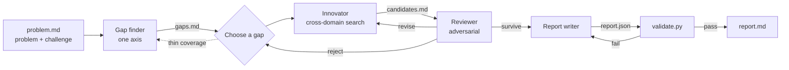

# idea-scientist

**English** · [简体中文](README.zh-CN.md)

A Claude skill that turns an open research problem into **one grounded, novel research proposal** — with every citation backed by a paper that was actually read.

It adapts the agent pipeline from [*IdeaScientist: Orchestrating Agents for Grounded Scientific Ideation*](https://arxiv.org/abs/2610.04074) (Liu et al., 2026) into a skill that runs inside Claude: no model server, no offline corpus, no training.

```text
You:    /idea-scientist Speculative decoding's draft acceptance collapses on code and
        long context. I don't want a bigger drafter or per-domain distillation.
        Give me a novel, practical research idea as a full proposal.

Claude: [maps prior work → finds a methodological gap → borrows a mechanism
         from another field → an adversarial reviewer tries to kill it →
         revises → writes the proposal → validates every citation]

        report.md: "Prefill residual memory": learn the draft–target residual on
        the prompt itself, borrowing residual learning from model-predictive
        control and the ρ/δ error split from multi-fidelity modelling …
```

## Why

Ask a model for "a novel idea" and it usually recombines the most obvious techniques from the same field. The method behind this skill rests on an old observation from cognitive science: new ideas often come from noticing that a challenge in one field has the same structure as a challenge another field has already solved. Two-stage retrieval in web search became cascade ranking in recommenders.

So the work is split into separate roles, each producing its own artifact:

| Role | What it does | Writes |
|---|---|---|
| **Gap finder** | Reads the closest same-problem prior work and states *one precise methodological reason* it falls short | `gaps.md` |
| **Innovator** | Searches *other* fields for a mechanism that beat an analogous challenge, reads it, argues why it transfers | `candidates.md` |
| **Reviewer** | Reads the closest work in full, writes a novelty argument (or a collision report), checks plausibility: survive / revise / reject | `scores.md` |
| **Report writer** | Develops the survivor into a complete, falsifiable proposal | `report.json` |
| **Paper reader** | Turns a paper's full text into a short, goal-focused digest | `papers/<id>.md` |

Claude acts as the **orchestrator**, keeping `plan.md` and deciding which role runs next:



Two rules make the output trustworthy:

- **Artifacts are the interface.** Roles communicate only through files with fixed schemas, so every stage can be inspected and any one stage sent back for rework.
- **Read before cite.** A paper may be cited only if a digest for it exists. `validate.py` checks this mechanically, because fabricated "near-miss" papers are the easiest way for ideation to look good while being wrong.

### What counts as a viable idea

The skill does not chase absolute originality, and it won't drop a direction just because related work exists. An idea is viable when it adds something **clear and meaningful** over the closest work: it pushes an existing idea further, fixes a concrete shortcoming, or reframes the problem into a more complete, more convincing story. The question is *what exactly does it add, and why does that matter* — not *has anything like it ever been done*.

It also refuses to manufacture novelty. An idea counts as a **collision** only when it overlaps with existing work on the core problem, the key method *and* the main contribution, judged after reading those papers in full. Then the reviewer names the papers and the exact overlap instead of arguing around it.

### Avoiding the usual idea shapes

Agents reviewing agents reward defensibility, so a pipeline like this drifts toward a few safe idea shapes whatever the problem: an analysis paper dressed as a method; a small mechanism wrapped in gates and fallbacks that "reduces to the baseline by construction"; and, above all, "change the objective" (reshape the reward, reweight, add a credit term), because it is the cheapest change that still counts as a method. [`references/thinking_traps.md`](idea-scientist/references/thinking_traps.md) names five such traps and a **lever space** — objective, representation, architecture, data, inference, interface, formulation, systems — that the roles use to widen the search:

- the **innovator** abstracts the challenge from two angles, compares at least three levers before committing, and states the idea's **core bet** and what it would buy on the problem's standard metric;
- on a rebuild, it replaces before it adds, and adds at most one component;
- the **reviewer** asks whether a different lever would make the candidate unnecessary (`revise(focus=lever)`) and whether its core has been buried under guards (`revise(focus=ambition)`);
- the **orchestrator** passes the levers already used as `AVOID_LEVER` to every fresh innovator call, and doesn't copy a base paper's design choices into the problem's constraints;
- the **report** names its lever and labels each prediction `upside`, `mechanism`, `safety` or `cost`; at least one must be an upside prediction on the standard metric.

None of these shapes is banned. The point is to reach them by comparison rather than by default.

## Installation

The skill needs **web search and web fetch** (to find and read papers) and **code execution** (for its helper scripts). The scripts use only the Python 3.9+ standard library, so there is nothing to `pip install`.

The skill itself is the [`idea-scientist/`](idea-scientist) folder of this repository. Install that folder, keeping its name: it must match the `name` in `SKILL.md`.

### Claude Code

```bash
git clone https://github.com/HuayuLiArizona/IdeaScientist-Claude-Skills.git
mkdir -p ~/.claude/skills

# personal: available in every project
cp -r IdeaScientist-Claude-Skills/idea-scientist ~/.claude/skills/

# or per project: shared with everyone who clones that project
mkdir -p .claude/skills && cp -r IdeaScientist-Claude-Skills/idea-scientist .claude/skills/
```

To pick up updates with `git pull`, link the folder instead of copying it:

```bash
ln -s "$PWD/IdeaScientist-Claude-Skills/idea-scientist" ~/.claude/skills/idea-scientist
```

### Claude.ai / Claude desktop app

1. Make sure code execution is on (**Settings → Capabilities** on Free, Pro and Max plans; on Team and Enterprise it is managed by your organization).
2. Build a ZIP of the `idea-scientist` folder. The commands below also drop the `disable-model-invocation` line from `SKILL.md`. That field is Claude Code–specific and not part of the standard skill format, which Claude.ai's uploader validates against.
   ```bash
   git clone https://github.com/HuayuLiArizona/IdeaScientist-Claude-Skills.git
   cd IdeaScientist-Claude-Skills
   mkdir -p build && cp -r idea-scientist build/
   grep -v '^disable-model-invocation:' idea-scientist/SKILL.md > build/idea-scientist/SKILL.md
   (cd build && zip -r ../idea-scientist.zip idea-scientist)
   ```
   GitHub's *Download ZIP* button wraps the whole repository in `IdeaScientist-Claude-Skills-main/`, so that file can't be uploaded as is. Unzip it and zip only the `idea-scientist` folder inside, after deleting that line.
3. Go to **Customize → Skills → + → Create skill → Upload a skill** and choose `idea-scientist.zip`.

See [Use skills in Claude](https://support.claude.com/en/articles/12512180-use-skills-in-claude) for plan-specific details.

## Usage

Run it explicitly with `/idea-scientist`, followed by your problem, topic, paper or idea, in English or Chinese. The skill **does not start on its own**: ordinary questions about research ideas get a normal answer, because a full run reads dozens of papers and takes a while. Typing `/idea-scientist` with nothing after it makes Claude ask what you want to work on.

```text
/idea-scientist quick: single-cell batch correction (Harmony, scVI…) erases real
biology when batch is confounded with condition. One fresh method idea, grounded.
```

```text
/idea-scientist 我在做 LLM 推理加速，speculative decoding 在代码和长上下文上接受率暴跌……
帮我想一个有新意、能落地的研究 idea，并写成完整的研究提案。
```

```text
/idea-scientist Retrospective test, use only literature published before 2025-06-01.
Problem: RAG answers badly when retrieved passages contradict each other …
```

How strictly "explicit only" is enforced depends on the platform:
- **Claude Code** enforces it with `disable-model-invocation: true`. Claude can't start the skill itself, but `/idea-scientist` always works.
- **Claude.ai** has no such switch, so there it relies on the skill's description, which tells Claude to run it only when you ask for it by name.

If you give only a topic, Claude proposes two or three concrete (problem, challenge) framings for you to pick from. If you give a paper, it extracts the problem and the limitation you care about.

### Checking your own idea

Bring an idea of your own and the skill switches to **user-idea mode**. It treats your idea as the thing to develop, not a seed to replace:

```text
/idea-scientist My idea: treat poisoned sensors in inverse PINNs like biased
observations in data assimilation, and estimate their error inflation online.
Has anyone done this? Check the novelty.
```

1. Your idea is written up faithfully as candidate C1, without swapping in a different mechanism.
2. A **novelty survey** finds the closest papers and reads them in full: problem setting, core method, technical details, contribution boundary. Each one is compared with your idea on problem, method and contribution.
3. You get one of three verdicts:
   - **Viable**, with a novelty argument: a paragraph on what your idea adds or advances and why it matters.
   - **Needs sharpening**, with the direction to sharpen. The skill can rebuild the idea, keeping your core and changing only the positioning or the weak component.
   - **Collision**, with a report naming the overlapping papers, where problem, method and contribution coincide, and why the remaining differences can't carry a novelty claim. The run stops there; it doesn't quietly substitute another idea.

By default you get the novelty assessment. Ask for a proposal and it continues to a full `report.md`.

### Options (just say them)

| Setting | Values | Default | Effect |
|---|---|---|---|
| Depth | `quick` · `standard` · `deep` | `standard` | Axes mapped, papers read, revise rounds, report length, self-evaluation |
| Literature cutoff | a date | none | Retrospective mode: nothing on or after the date may be read or cited, including later arXiv versions of earlier papers |
| Output language | any | your language | Prose follows the language of your request; JSON keys stay English |
| Retrieval backend | `web` · `api` · `vault` | `web` | See below |

| | quick | standard | deep |
|---|---|---|---|
| Challenge axes mapped | 1 | 1–2 | 2–3 |
| Rebuilds after a `revise` verdict | 1 | 2 | 3 |
| Report length | ~1–2k words | ~2.5–4k words | as needed |
| Self-evaluation | none | quality + cross-domain transfer | full, incl. blind non-obviousness test |
| Papers read, at most | 20 | 45 | 80 |
| Sanity checks, at most | 1 | 3 | 6 |
| Wrap-up / hard stop | 30 / 45 min | 75 / 120 min | 150 / 240 min |

Every run has hard limits. After each role call, `scripts/status.py` reports `CONTINUE`, `WRAP UP` (stop exploring, commit the best candidate, write the report) or `STOP` (no more reading; deliver with what exists). Each role call also has its own caps on papers read and web searches. A run that hits a limit before any candidate passes review delivers a *forced commit*, and says so.

**Sanity checks.** The innovator and the reviewer may each run one quick numerical toy per call to test a load-bearing claim — for example, whether a transferred mechanism's key assumption holds at toy scale. Each check:
- is pre-registered in `checks.md` with its question and kill criterion *before* it runs;
- is limited to a small CPU script with a 5-minute timeout;
- informs decisions only. It never appears as a result in the proposal, and the rendered report lists all checks in an appendix labelled as toy checks.

See `references/sanity_checks.md`.

### Retrieval backends

- **`web`** (default): WebSearch to find papers, WebFetch to read full text (`arxiv.org/html/<id>`, `/pdf/<id>`, bioRxiv, ACL Anthology, OpenReview, publisher pages). Works everywhere.
- **`api`**: arXiv, Semantic Scholar or OpenAlex APIs via `scripts/lit_search.py`, when your shell can reach them. Run `python idea-scientist/scripts/lit_search.py check` to find out. Set `S2_API_KEY` for higher Semantic Scholar rate limits.
- **`vault`**: a local copy of the [Svalbard Idea Vault](https://huggingface.co/datasets/Jerry999/SvalbardIdeaVault) from the original paper. Set `IDEASCIENTIST_KEYWORD_INDEX` (FTS5 index) and `IDEA_VAULT_DB` (paper database).

## What you get

Each run creates a directory with every intermediate artifact:

```text
ideation-<slug>/
├── problem.md        problem definition, challenge, axes, settings
├── plan.md           orchestrator state machine + decision history
├── gaps.md           per-axis survey: what has been done, ≤2 methodological gaps
├── candidates.md     C1, C2, … — intuitions with their source mechanisms
├── scores.md         reviewer verdicts, search trails, strongest objections
├── checks.md         pre-registered sanity checks (scripts in checks/)
├── papers/           one goal-by-goal digest per paper read
├── report.json       the proposal, in a fixed results-masked schema
├── report.md         rendered proposal with numbered, linked references
└── evaluation.md     self-evaluation (standard / deep)
```

`report.md` covers: thesis · core problem with a concrete failing example · key novelty · formal problem definition · related work by sub-area, with the gap each leaves · method (flow, modules, design choices, theoretical grounding, pseudocode) · model and training · comparison to the state of the art · evaluation plan · falsifiable predictions, each with a kill condition · limitations.

The proposal is **results-masked**: it says what would be built, how it would be tested, and what observation would prove it wrong. It never reports results.

## Helper scripts

The skill calls these itself; you can also run them by hand. From the repository root:

```bash
S=idea-scientist/scripts
python $S/init_run.py ideation-foo --depth quick --cutoff 2025-06-01 --language zh
python $S/status.py ideation-foo              # budget check: CONTINUE / WRAP UP / STOP, plus levers used
python $S/lit_search.py check
python $S/lit_search.py search --backend arxiv "cascade ranking latency" --k 20 --before 2025-06-01
python $S/lit_search.py path "doi:10.1101/2023.06.01.543210"   # digest path for an ID
python $S/validate.py ideation-foo            # validity gates; exit code 1 on FAIL
python $S/render_report.py ideation-foo       # report.json → report.md
```

`validate.py` mirrors the reward gates of the original system:

- **Schema:** every run file and every proposal field is present and filled.
- **Gaps:** at most 2 per axis, each with all five fields.
- **Idea shape:** candidates name a lever and the alternatives it beat; the report has an `upside` prediction (WARN when safety and cost predictions are more than half, when every fresh candidate uses the same lever, or when the thesis reads like an analysis paper).
- **Read before cite:** every cited ID resolves to a digest.
- **No fake results:** no placeholders and no "achieves X%" phrasing.
- **Cutoff:** in cutoff runs, both the paper's date and the date of the version actually read must fall before the cutoff.

## Repository layout

```text
README.md · README.zh-CN.md
idea-scientist/                 ← the skill (install this folder)
  SKILL.md                      orchestrator: intake, loop, budgets, delivery
  NOTICE.md                     attribution and license
  references/
    retrieval.md                paper IDs, search regimes, search budget, digests, cutoff rules
    schemas.md                  format of every run file
    sanity_checks.md            rules for quick numerical toy checks
    thinking_traps.md           the five idea-shape traps and the lever space
    evaluation.md               self-evaluation rubrics
    roles/                      gap_finder · innovator · reviewer · report_writer · paper_reader
  scripts/
    init_run.py · status.py · lit_search.py · validate.py · render_report.py · _ids.py · _levers.py
  assets/
    report_schema.json          proposal skeleton
```

## Evaluation

We tested the skill with Claude on three prompts: an ML-systems problem in Chinese, a retrospective RAG problem with a 2025-06-01 cutoff, and a quick single-cell biology problem. Each prompt was run with and without the skill and graded against 10–11 assertions.

| | With skill | Without skill |
|---|---|---|
| Assertions passed | **30 / 31 (97%)** | 18 / 31 (58%) |
| Mean wall-clock | ~34 min | ~34 min |
| Mean tokens | ~275k | ~134k |

The baseline failed these assertions; the skill passed them all:

| Assertion | Baseline failed |
|---|---|
| Every cited paper was actually read | 3 of 3 |
| Every prediction has a refutation condition | 3 of 3 |
| Genuine cross-domain transfer | 2 of 3 |
| An explicit adversarial novelty check | 2 of 3 |

The skill's one failure was a post-cutoff paper version read in the retrospective run. That led to the version checks now in `validate.py` and `retrieval.md`.

Caveats:
- This is a small test: one run per configuration, graded by Claude.
- The current version includes fixes made after this round and has not been re-benchmarked.
- On one prompt the baseline gave a more detailed deployment-cost analysis. The report writer now asks for one whenever practicality matters.

## Differences from the original IdeaScientist

| Original system | This skill |
|---|---|
| Orchestrator is a fixed LLM prompt in a Python runner | Claude follows `SKILL.md` as the orchestrator |
| Roles are separate model calls with tool allow-lists | Roles run as subagents, or inline when subagents are unavailable |
| Offline Svalbard Idea Vault (4.7M papers, BM25 + embeddings) | Live web search by default; APIs or a local vault optional |
| Gap finder, innovator and report writer trained with per-role GRPO LoRA adapters | No training: the same role contracts, followed through prompting |
| Integer vault IDs | Prefixed IDs: `arXiv:`, `doi:`, `acl:`, `openreview:`, `pmid:`, `ref:` |
| — | Idea-shape safeguards: a lever space, core-bet and guard audits, `AVOID_LEVER` steering, prediction kinds (`references/thinking_traps.md`) |

## Limitations

- **Cost.** A standard run reads roughly 15–40 papers and typically takes 30–75 minutes, with a hard stop at 2 hours (4 hours for `deep`). Theory-heavy problems tend to run into the limits; when they do, the result is a forced commit rather than a reviewed survivor.
- **Search rate limits.** Web search is rate-limited, and parallel runs drain the budget for each other. When search runs out, the skill keeps going by snowballing from papers it has already read, and says in the report which checks were incomplete.
- **Inline mode.** Without a subagent tool, a single Claude plays every role. The stages are then less independent, and the blind non-obviousness test is skipped.
- **Coverage.** Coverage is only as good as what web search and fetch can reach. Paywalled papers may only be available as abstracts, and the skill marks those digests as abstract-only.
- **Unvalidated ideas.** The output is an unexecuted proposal. Novelty checks reduce the risk of rediscovering existing work but can't rule it out, and self-evaluation scores are diagnostics, not verdicts.

## Citation

This skill is an adaptation. If you use it in research, please cite the original work:

```bibtex
@article{liu2026ideascientist,
  title   = {IdeaScientist: Orchestrating Agents for Grounded Scientific Ideation},
  author  = {Liu, Jiarui and Tao, Renjie and Liao, Yiwei and Jin, Chuanyang and Sun, Kai and
             Yang, Xiao and Zhang, Xinyuan and Chen, Xilun and Huang, Zhuangqun and Zhang, Lechen and
             Yang, Yongjin and He, Yinghui and Xuan, Weihao and Wanga, Rakesh and Kumar, Anuj and
             Diab, Mona T. and Yih, Wen-tau and Dong, Xin Luna},
  journal = {arXiv preprint arXiv:2610.04074},
  year    = {2026}
}
```

Original code: [jiarui-liu/IdeaScientist](https://github.com/jiarui-liu/IdeaScientist) · Dataset: [Jerry999/SvalbardIdeaVault](https://huggingface.co/datasets/Jerry999/SvalbardIdeaVault)

## License

[CC BY-NC 4.0](https://creativecommons.org/licenses/by-nc/4.0/). The role instructions, artifact schemas, orchestration loop, validity gates and evaluation rubrics are adapted from the original IdeaScientist repository, which is released under CC BY-NC 4.0, so this skill is shared under the same terms: attribution required, non-commercial use only. See [`idea-scientist/NOTICE.md`](idea-scientist/NOTICE.md).
