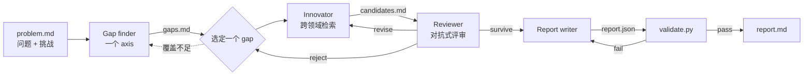

# idea-scientist

[English](README.md) · **简体中文**

一个 Claude skill：把一个开放的研究问题变成**一份有依据、有新意的研究提案**，提案里引用的每一篇论文都真的读过。

它把论文 [*IdeaScientist: Orchestrating Agents for Grounded Scientific Ideation*](https://arxiv.org/abs/2610.04074)（Liu et al., 2026）里的多智能体流程改写成在 Claude 里直接运行的 skill。不需要部署模型服务，不需要离线语料库，也不需要训练。

```text
你：    /idea-scientist speculative decoding 在代码和长上下文上接受率暴跌，
        不想换更大的 draft model，也不想按领域单独蒸馏。帮我想个有新意、能落地的 idea，写成完整提案。

Claude：[梳理相关工作 → 找出方法层面的缺口 → 从别的领域借一个机制 →
         对抗式评审尝试推翻 → 修改 → 写成提案 → 逐条核验引用]

        report.md：「Prefill 残差记忆」：直接在 prompt 上学 draft 与 target 的残差，
        借用模型预测控制（MPC）的残差学习和多保真建模的 ρ/δ 误差分解……
```

## 为什么这样设计

直接让模型"想一个新 idea"，它多半会把本领域最常见的技术重新组合一遍。这个方法基于认知科学里一个由来已久的观察：新想法常常来自发现某个领域的难题与另一个领域已经解决的问题在结构上相同。例如网页搜索里的"两阶段检索"，后来就成了推荐系统里的级联排序。

所以流程拆成几个角色，每个角色只产出自己负责的文件：

| 角色 | 做什么 | 写入 |
|---|---|---|
| **Gap finder** | 读同一问题下最接近的已有工作，指出它们在方法上不足的一个具体原因 | `gaps.md` |
| **Innovator** | 到**其他领域**找解决过类似难题的机制，读原文，论证为什么能迁移过来 | `candidates.md` |
| **Reviewer** | 完整阅读最接近的工作，写出 novelty 论证（或撞车报告），并检查可行性，给出 survive / revise / reject | `scores.md` |
| **Report writer** | 把通过评审的 idea 写成完整、可证伪的提案 | `report.json` |
| **Paper reader** | 把论文全文压缩成针对具体问题的简短摘要 | `papers/<id>.md` |

Claude 自己担任 **orchestrator**：维护 `plan.md`，决定下一步调用哪个角色。



两条规则保证输出可信：

- **文件就是接口。** 角色之间只通过固定格式的文件交流，每个阶段都能检查，也能把单个阶段退回重做。
- **先读后引。** 只有在 `papers/` 里有摘要的论文才能被引用。`validate.py` 会机械地检查这一点。编造"相近工作"是让 idea 看起来很好、实际却站不住的最省事的办法，所以必须堵住。

### 什么样的 idea 算可行

这个 skill 不追求"绝对原创"或"从未有人做过"，也不会因为已有相似工作就轻易否定一个方向。只要 idea 相对最接近的工作有**清晰且有意义的增量**，就是可行的。比如把已有思路推进一步、加以完善或深化，解决已有方法的具体不足，或者从新的视角重新组织问题，讲出一个更完整、更有说服力的故事。判断的重点是"到底新增了什么、为什么重要"，而不是"有没有先例"。

反过来，它也不会为了保留 idea 而强行制造 novelty。只有在完整读过最接近的论文之后，发现在核心问题、关键方法和主要贡献这三方面**同时**高度重合、已无法形成实质区分时，才判定为"撞车"。这时评审会明确指出与哪些工作撞车、具体重合在哪里。

## 安装

这个 skill 需要**网页搜索和网页抓取**（找论文、读论文）以及**代码执行**（运行辅助脚本）。脚本只用 Python 3.9+ 标准库，不需要 `pip install` 任何东西。

skill 本体是本仓库里的 [`idea-scientist/`](idea-scientist) 文件夹。安装时装这个文件夹，并保持文件夹名不变，它必须与 `SKILL.md` 里的 `name` 一致。

### Claude Code

```bash
git clone https://github.com/HuayuLiArizona/IdeaScientist-Claude-Skills.git
mkdir -p ~/.claude/skills

# 个人：所有项目都能用
cp -r IdeaScientist-Claude-Skills/idea-scientist ~/.claude/skills/

# 项目级：克隆该项目的人都能用
mkdir -p .claude/skills && cp -r IdeaScientist-Claude-Skills/idea-scientist .claude/skills/
```

想用 `git pull` 直接获取更新的话，可以用软链接代替复制：

```bash
ln -s "$PWD/IdeaScientist-Claude-Skills/idea-scientist" ~/.claude/skills/idea-scientist
```

### Claude.ai / Claude 桌面版

1. 确认已开启代码执行。Free、Pro、Max 套餐在 **Settings → Capabilities** 里打开；Team 和 Enterprise 由组织管理员控制。
2. 把 `idea-scientist` 文件夹打成 ZIP。下面的命令会顺带去掉 `SKILL.md` 里的 `disable-model-invocation` 这一行。这个字段是 Claude Code 专有的，不在标准 skill 格式里，而 Claude.ai 的上传会按标准格式校验。
   ```bash
   git clone https://github.com/HuayuLiArizona/IdeaScientist-Claude-Skills.git
   cd IdeaScientist-Claude-Skills
   mkdir -p build && cp -r idea-scientist build/
   grep -v '^disable-model-invocation:' idea-scientist/SKILL.md > build/idea-scientist/SKILL.md
   (cd build && zip -r ../idea-scientist.zip idea-scientist)
   ```
   GitHub 网页上 *Download ZIP* 下载的文件，外面多包了一层 `IdeaScientist-Claude-Skills-main/`，不能直接上传。需要先解压，删掉那一行，再只把里面的 `idea-scientist` 文件夹压缩成 ZIP。
3. 进入 **Customize → Skills → + → Create skill → Upload a skill**，选择 `idea-scientist.zip`。

各套餐的具体要求见 [Use skills in Claude](https://support.claude.com/en/articles/12512180-use-skills-in-claude)。

## 使用

用 `/idea-scientist` 主动唤起，后面跟上你的问题、方向、论文或 idea，中英文都可以。这个 skill **不会自动启动**：平时问研究 idea 相关的问题，Claude 会正常回答。这样设计是因为完整跑一轮要读几十篇论文，耗时较长。只输入 `/idea-scientist` 不带内容时，Claude 会先问你想做什么。

```text
/idea-scientist 我在做 LLM 推理加速，speculative decoding 在代码和长上下文上接受率暴跌……
帮我想一个有新意、能落地的研究 idea，并写成完整的研究提案。
```

```text
/idea-scientist quick：单细胞批次校正（Harmony、scVI 等）在批次和疾病状态混杂时
会把真实的生物信号也校正掉。给我一个新方法 idea，快一点，但要有依据。
```

```text
/idea-scientist 回溯测试，只用 2025-06-01 之前发表的文献。
问题：检索到的段落互相矛盾时，RAG 系统的回答很差……
```

"只在主动唤起时运行"在不同平台上的保证程度不同：
- **Claude Code**：通过 `disable-model-invocation: true` 强制保证。Claude 无法自行启动这个 skill，但 `/idea-scientist` 始终可用。
- **Claude.ai**：没有对应的开关，只能靠 skill 的描述来约束。描述里明确写了"只有用户点名要求时才运行"。

只给一个大方向时，Claude 会先提出两三种具体的（问题，挑战）表述让你挑；给一篇论文时，它会提取出问题和你关心的局限。

### 检查你自己的 idea

如果你带着自己的 idea 来，skill 会切换到 **user-idea 模式**。它会把你的 idea 当作要发展的对象，而不是拿来替换的种子：

```text
/idea-scientist 我的 idea：把逆问题 PINN 里被投毒的传感器，看成数据同化里有偏差的观测，
在线估计它们的误差膨胀系数。这个方向有人做过吗？帮我查一下 novelty。
```

1. 先把你的 idea 如实整理成候选 C1，不会换成别的机制。
2. 然后做 **novelty 调研**：找出最接近的论文，完整阅读它们的问题设定、核心方法、技术细节和贡献边界，逐篇在问题、方法、贡献三方面与你的 idea 对比。
3. 最后给出三种结论之一：
   - **可行**：附一段 novelty 论证，说明你的 idea 具体新增了什么、推进了什么，以及为什么这种差异有意义。
   - **需要打磨**：指出该往哪个方向强化区分度。skill 可以在保留你核心思路的前提下重做，只调整定位或薄弱的部分。
   - **撞车**：附撞车报告，列出重合的论文，说明问题、方法、贡献在哪些地方重合，以及为什么剩下的差异撑不起一个可信的 novelty claim。运行到此结束，不会悄悄换成另一个 idea。

默认只交付 novelty 评估。如果要求写提案，它会继续写出完整的 `report.md`。

### 可选设置（用自然语言说出来即可）

| 设置 | 取值 | 默认 | 作用 |
|---|---|---|---|
| 深度 | `quick` · `standard` · `deep` | `standard` | 决定梳理几个 axis、读多少论文、修改几轮、报告多长、要不要自评 |
| 文献截止日期 | 一个日期 | 无 | 回溯模式：截止日期当天及之后的内容一律不能读也不能引，包括早期论文在截止后更新的 arXiv 版本 |
| 输出语言 | 任意 | 跟随你的提问语言 | 正文跟随提问语言，JSON 字段名保持英文 |
| 检索方式 | `web` · `api` · `vault` | `web` | 见下文 |

| | quick | standard | deep |
|---|---|---|---|
| 梳理的 challenge axis | 1 | 1–2 | 2–3 |
| `revise` 后最多重做几次 | 1 | 2 | 3 |
| 报告长度 | 约 1–2k 词 | 约 2.5–4k 词 | 按需 |
| 自评 | 无 | 质量 + 跨领域迁移 | 全部，含盲测的"非显然性"检验 |
| 最多读论文 | 20 | 45 | 80 |
| 最多玩具验证 | 1 | 3 | 6 |
| 收尾 / 强制停止 | 30 / 45 分钟 | 75 / 120 分钟 | 150 / 240 分钟 |

每次运行都有硬上限。每次调用角色之后，`scripts/status.py` 会给出三种结论之一：`CONTINUE`（继续）、`WRAP UP`（停止探索，选出最好的候选写报告）、`STOP`（不再读论文，用现有材料交付）。每次角色调用对读论文数和检索次数也各有上限。如果撞到上限时还没有候选通过评审，就会以"强制提交"的方式交付，并在交付时明确说明。

**玩具验证。** innovator 和 reviewer 每次调用可以跑一个快速的数值玩具实验，用来检验某个关键前提，比如迁移过来的机制所依赖的假设在小规模下是否成立。每个验证：
- 运行之前必须先在 `checks.md` 里写明要检验的问题和证伪标准；
- 只能是小型 CPU 脚本，5 分钟超时；
- 只用于辅助决策，不会作为结果写进提案。渲染出的报告会把所有验证列在附录里，并注明是玩具验证。

详见 `references/sanity_checks.md`。

### 检索方式

- **`web`**（默认）：用 WebSearch 找论文，用 WebFetch 读全文，来源包括 `arxiv.org/html/<id>`、`/pdf/<id>`、bioRxiv、ACL Anthology、OpenReview 和出版社页面。在哪里都能用。
- **`api`**：shell 能联网时，通过 `scripts/lit_search.py` 调用 arXiv、Semantic Scholar 或 OpenAlex 的 API。先运行 `python idea-scientist/scripts/lit_search.py check` 看能不能连上。设置 `S2_API_KEY` 可以提高 Semantic Scholar 的限额。
- **`vault`**：使用原论文的 [Svalbard Idea Vault](https://huggingface.co/datasets/Jerry999/SvalbardIdeaVault) 本地副本。需要设置 `IDEASCIENTIST_KEYWORD_INDEX`（FTS5 索引）和 `IDEA_VAULT_DB`（论文数据库）。

## 产出

每次运行生成一个目录，所有中间产物都保留：

```text
ideation-<slug>/
├── problem.md        问题定义、挑战、axis、设置
├── plan.md           orchestrator 的状态机和决策记录
├── gaps.md           每个 axis 的综述：已有做法，以及最多 2 个方法层面的 gap
├── candidates.md     C1、C2……每个 idea 及其借鉴的来源机制
├── scores.md         评审结论、检索记录、最强反对意见
├── checks.md         事先登记的玩具验证（脚本在 checks/ 下）
├── papers/           每篇读过的论文一份按问题作答的摘要
├── report.json       提案，固定的 results-masked 格式
├── report.md         渲染后的提案，带编号和链接的参考文献
└── evaluation.md     自评（standard / deep）
```

`report.md` 包含：核心论点 · 核心问题及具体失败案例 · 核心创新 · 形式化问题定义 · 按子方向整理的相关工作及各自留下的 gap · 方法（流程、模块、设计选择、理论依据、伪代码）· 模型与训练 · 与现有方法的比较 · 评估计划 · 每条都带证伪条件的预测 · 局限性。

提案是 **results-masked** 的：只写要做什么、怎么验证、出现什么结果就说明它错了，绝不写实验结果。

## 辅助脚本

skill 会自动调用这些脚本，你也可以在仓库根目录手动运行：

```bash
S=idea-scientist/scripts
python $S/init_run.py ideation-foo --depth quick --cutoff 2025-06-01 --language zh
python $S/status.py ideation-foo              # 预算检查：CONTINUE / WRAP UP / STOP
python $S/lit_search.py check
python $S/lit_search.py search --backend arxiv "cascade ranking latency" --k 20 --before 2025-06-01
python $S/lit_search.py path "doi:10.1101/2023.06.01.543210"   # 某个 ID 对应的摘要路径
python $S/validate.py ideation-foo            # validity gate，有 FAIL 时退出码为 1
python $S/render_report.py ideation-foo       # report.json → report.md
```

`validate.py` 复刻了原系统奖励函数里的 validity gate：

- **格式：** 所有运行文件和提案字段都存在且有内容。
- **Gap：** 每个 axis 最多 2 个，每个都有 5 个必填字段。
- **先读后引：** 每个被引用的 ID 都有对应摘要。
- **不编结果：** 没有占位符，也没有"达到 X%"这类写法。
- **截止日期：** 回溯模式下，论文日期和实际所读版本的日期都必须早于截止日。

## 仓库结构

```text
README.md · README.zh-CN.md
idea-scientist/                 ← skill 本体（安装这个文件夹）
  SKILL.md                      orchestrator：接收问题、主循环、预算、交付
  NOTICE.md                     署名与许可
  references/
    retrieval.md                论文 ID、两种检索方式、检索预算、摘要格式、截止规则
    schemas.md                  各运行文件的格式
    sanity_checks.md            快速数值玩具验证的规则
    evaluation.md               自评标准
    roles/                      gap_finder · innovator · reviewer · report_writer · paper_reader
  scripts/
    init_run.py · status.py · lit_search.py · validate.py · render_report.py · _ids.py
  assets/
    report_schema.json          提案模板
```

## 测试结果

用 Claude 跑了三道题：一道中文的 ML 系统问题，一道截止日期为 2025-06-01 的 RAG 回溯题，一道 quick 模式的单细胞生物学题。每道题分别在有 skill 和无 skill 的情况下运行，按 10–11 条断言评分。

| | 有 skill | 无 skill |
|---|---|---|
| 通过断言 | **30 / 31（97%）** | 18 / 31（58%） |
| 平均耗时 | 约 34 分钟 | 约 34 分钟 |
| 平均 token | 约 275k | 约 134k |

下面几条断言 skill 版本全部通过，无 skill 版本失败：

| 断言 | 无 skill 失败次数 |
|---|---|
| 引用的论文都真的读过 | 3 / 3 |
| 每条预测都有证伪条件 | 3 / 3 |
| 真正的跨领域迁移 | 2 / 3 |
| 做了明确的对抗式查新 | 2 / 3 |

skill 唯一的失败，是回溯测试里读到了截止日之后的论文版本。现在 `validate.py` 和 `retrieval.md` 里的版本检查就是为此加的。

说明：
- 测试规模小：每种配置只跑一次，由 Claude 评分。
- 当前版本包含这轮测试之后的修复，还没有重新测试。
- 有一道题里，无 skill 版本的部署开销分析更细。现在只要题目关心落地，report writer 就会要求给出开销估算。

## 与原版 IdeaScientist 的区别

| 原系统 | 本 skill |
|---|---|
| orchestrator 是 Python 程序里的固定 LLM prompt | 由 Claude 按 `SKILL.md` 担任 orchestrator |
| 各角色是独立的模型调用，各有工具白名单 | 各角色作为子 agent 运行；没有子 agent 工具时由 Claude 依次扮演 |
| 离线的 Svalbard Idea Vault（470 万篇论文，BM25 + 向量检索） | 默认实时网页检索；也可选用 API 或本地 vault |
| Gap finder、innovator、report writer 用逐角色 GRPO 训练 LoRA adapter | 不训练：保留同样的角色约定，靠提示词执行 |
| vault 内部的整数 ID | 带前缀的 ID：`arXiv:`、`doi:`、`acl:`、`openreview:`、`pmid:`、`ref:` |

## 局限

- **成本：** 一次 standard 运行大约读 15–40 篇论文，通常耗时 30–75 分钟，最多 2 小时强制停止（`deep` 为 4 小时）。偏理论的问题更容易撞到上限，这时交付的是强制提交的候选，而不是通过评审的候选。
- **检索限额：** 网页搜索有频率限制，并行运行时会互相挤占额度。额度用完后，skill 会从已读论文的参考文献里继续追溯，并在报告中写明哪些检查没有做完。
- **inline 模式：** 没有子 agent 工具时，所有角色由同一个 Claude 扮演，各阶段之间的独立性变弱，盲测的非显然性检验会跳过。
- **覆盖范围：** 覆盖面取决于网页搜索和抓取能拿到什么。付费墙后的论文可能只能读到摘要，skill 会把这类摘要标为 abstract-only。
- **未经验证：** 产出是未执行的提案。查新能降低重复已有工作的风险，但不能完全排除；自评分数只用于诊断，不是结论。

## 引用

本 skill 是改编作品。如果在研究中使用，请引用原论文：

```bibtex
@article{liu2026ideascientist,
  title   = {IdeaScientist: Orchestrating Agents for Grounded Scientific Ideation},
  author  = {Liu, Jiarui and Tao, Renjie and Liao, Yiwei and Jin, Chuanyang and Sun, Kai and
             Yang, Xiao and Zhang, Xinyuan and Chen, Xilun and Huang, Zhuangqun and Zhang, Lechen and
             Yang, Yongjin and He, Yinghui and Xuan, Weihao and Wanga, Rakesh and Kumar, Anuj and
             Diab, Mona T. and Yih, Wen-tau and Dong, Xin Luna},
  journal = {arXiv preprint arXiv:2610.04074},
  year    = {2026}
}
```

原始代码：[jiarui-liu/IdeaScientist](https://github.com/jiarui-liu/IdeaScientist) · 数据集：[Jerry999/SvalbardIdeaVault](https://huggingface.co/datasets/Jerry999/SvalbardIdeaVault)

## 许可

[CC BY-NC 4.0](https://creativecommons.org/licenses/by-nc/4.0/deed.zh-hans)。角色说明、产物格式、编排流程、validity gate 和评估标准改编自原 IdeaScientist 仓库，原仓库采用 CC BY-NC 4.0，因此本 skill 沿用相同条款：须署名，仅限非商业用途。详见 [`idea-scientist/NOTICE.md`](idea-scientist/NOTICE.md)。
